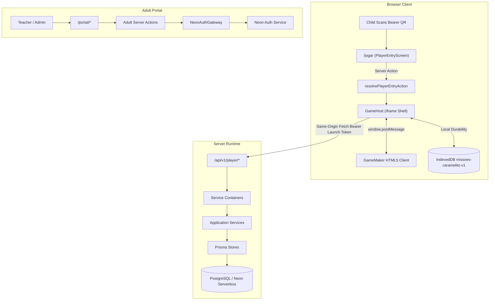

# Comprehensive Architectural Audit & Future Risk Assessment

**Platform:** Missões do Caramelito (SMS Portal)  
**Date of Audit:** October 12, 2026  
**Audited Target:** Next.js 16 (App Router / Proxy) + Prisma 7 + Neon Serverless + GameMaker V1 Bridge  
**Status:** Audit Complete — No Code Modified

---

## Executive Summary

A comprehensive architectural investigation was conducted across the `SMS_Portal` codebase, covering persistence, security, multi-tenancy, transport protocol, offline synchronization, build tooling, and operational stability.

The platform demonstrates high architectural rigor in several core areas:

- Strict domain separation between the adult administrative portal and the GameMaker game runtime.
- Data minimization for children (opaque, attendance-index numbered slots without PII or child accounts).
- Robust bearer QR token generation with HKDF-derived AES-256-GCM authenticated encryption and AAD row-binding.
- Idempotent event ingestion with dual-tier SHA-256 fingerprinting in IndexedDB and database unique constraints.
- Solid Compare-And-Swap (CAS) optimistic concurrency control on game state revisions.

However, the investigation identified **critical architectural gaps and scalability risks** that will incur operational failures as the platform transitions from isolated local testing to live classroom deployments across real schools and shared tablets:

1. **Critical Production DB Connection Leak**: `getPrisma()` creates a brand-new `PrismaClient` and `PrismaNeon` adapter on _every single request_ in `NODE_ENV=production` due to an inverted singleton cache check.
2. **The "5-Minute Token Trap" on Offline Reconnection**: When tablets play offline for $>5$ minutes and the teacher closes the session before the tablet reconnects, offline sync attempts to refresh the expired launch token via `resolveEntry()`, which rejects ended sessions. The tablet can never obtain a fresh token, permanently stranding the student's queued events in IndexedDB.
3. **State Save vs Result Inconsistency on Session End**: If a teacher ends a session while children are playing or syncing, state saves are rejected with `409 SESSION_ENDED`, while result events are accepted. This leads to student progress rollbacks despite teacher dashboards recording completion.
4. **O(N) In-Memory Report Computation**: Class reports query _all_ raw `result_events` and `active_time_events` into Node.js memory to compute sums and counts in JavaScript rather than using SQL aggregation, creating query latency and memory spikes under realistic classroom history.
5. **Zero Key Versioning for AES-256-GCM Cipher**: Rotating `APPLICATION_SECRET` makes all stored QR credentials permanently unrecoverable for reprinting.
6. **Adult User Onboarding Void**: There is no self-registration or invite-acceptance mechanism linking Neon Auth users to `ProfessionalProfile` records; adult accounts must be manually seeded in the database.

---

## 1. System Context & Architectural Boundaries

Missões do Caramelito operates across three connected runtime surfaces:

1. **Authenticated Professional/Admin Portal**: Role-based web portal for Platform Administrators, Organization Administrators, and Teachers (`src/app/(professional)/portal/*`).
2. **Player Entry & Context-Resolution Surface**: Low-friction QR scanner and entry gate (`/jogar`), minting short-lived HMAC launch tokens.
3. **External GameMaker Runtime**: Browser HTML5 canvas client hosted in an `<iframe>` communicating with the host via `window.postMessage` (`src/components/public/game-host.tsx`).

Transport between GameMaker and the backend is defined by frozen JSON Schemas (`contracts/schemas/v1/`) and implemented over `/api/v1/player/*`.



---

## 2. High-Severity Architectural Gaps & Future Failure Modes

### 2.1 Production Database Connection Leak (`src/server/db/client.ts`)

- **Location**: [`src/server/db/client.ts:17-25`](file:///c:/Users/Vitor/Desktop/Vinicius/Projetos/SMS_Portal/src/server/db/client.ts#L17-L25)
- **The Issue**:
  ```typescript
  export function getPrisma(): PrismaClient {
    const client = globalForPrisma.prisma ?? createPrismaClient();

    if (process.env.NODE_ENV !== "production") {
      globalForPrisma.prisma = client;
    }

    return client;
  }
  ```
  In Next.js, assigning to `globalThis` is intended to prevent hot-reload duplicates in _development_. However, because `globalForPrisma.prisma` is _never_ assigned in `production` (`process.env.NODE_ENV !== "production"` is `false`), every single call to `getPrisma()` executes `createPrismaClient()`.
- **Future Impact**:
  - In a production environment under classroom traffic (e.g., 30 tablets bootstrapping and streaming events simultaneously), thousands of `PrismaClient` and `PrismaNeon` connection instances will be spawned.
  - This guarantees memory exhaustion in Node.js processes/containers and PostgreSQL connection pool starvation on Neon Serverless, triggering `500 INTERNAL_SERVER_ERROR` or process crashes.
- **Remediation**:
  Assign the client singleton unconditionally in module scope:
  ```typescript
  const prismaClient = globalForPrisma.prisma ?? createPrismaClient();
  if (process.env.NODE_ENV !== "production") {
    globalForPrisma.prisma = prismaClient;
  }
  export function getPrisma(): PrismaClient {
    return prismaClient;
  }
  ```

---

### 2.2 The "5-Minute Token Trap" on Offline Reconnection

- **Locations**:
  - [`src/server/security/launch-token.ts:3`](file:///c:/Users/Vitor/Desktop/Vinicius/Projetos/SMS_Portal/src/server/security/launch-token.ts#L3)
  - [`src/components/public/game-host.tsx:125-150`](file:///c:/Users/Vitor/Desktop/Vinicius/Projetos/SMS_Portal/src/components/public/game-host.tsx#L125-L150)
  - [`src/application/player-access/service.ts:193-205`](file:///c:/Users/Vitor/Desktop/Vinicius/Projetos/SMS_Portal/src/application/player-access/service.ts#L193-L205)
- **The Issue**:
  1. The launch token carries a strict 5-minute TTL (`LAUNCH_TOKEN_TTL_SECONDS = 300`).
  2. While online, `GameHost.validLaunchToken()` periodically renews the launch token by calling `resolvePlayerEntryAction(credential)`.
  3. However, if a school tablet plays offline (or on flaky school Wi-Fi) for more than 5 minutes, the launch token expires.
  4. If the class session ends or the teacher clicks "Encerrar Sessão" before the tablet reconnects, `resolvePlayerEntryAction` queries `findOrCreateActiveParticipation()`.
  5. Because the session is no longer `ACTIVE`, `resolveEntry()` returns `{ state: "waiting" }`.
  6. `validLaunchToken()` throws: `"A turma ainda está se preparando"`.
- **Future Impact**:
  - In `src/application/game-events/service.ts:59-61`, the server code explicitly intended to allow a late flush for results even after a session ends.
  - However, because the client cannot authenticate with an expired launch token and `resolveEntry()` refuses to issue a token for ended sessions, **all queued offline results and active-time records in IndexedDB are permanently stranded**.
  - If a new session begins later, the old records remain in IndexedDB forever because `expectedClassSessionId` prevents cross-session uploading.
- **Remediation**:
  - Introduce a dedicated token refresh mechanism or allow `resolvePlayerEntryAction` to return a restricted, short-lived "flush-only" token for the player's most recent participation when unacknowledged events exist in the offline store.

---

### 2.3 State Save Rejection (`SESSION_ENDED`) vs Result Acceptance Inconsistency

- **Locations**:
  - [`src/application/game-state/service.ts:98-100`](file:///c:/Users/Vitor/Desktop/Vinicius/Projetos/SMS_Portal/src/application/game-state/service.ts#L98-L100)
  - [`src/application/game-events/service.ts:59-61`](file:///c:/Users/Vitor/Desktop/Vinicius/Projetos/SMS_Portal/src/application/game-events/service.ts#L59-L61)
- **The Issue**:
  - When saving world/game state (`/api/v1/player/state`), `GameStateService.requireLaunch` asserts:
    ```typescript
    if (scope.sessionStatus !== GameSessionStatus.ACTIVE) {
      throw new GameStateError("SESSION_ENDED"); // 409 Conflict
    }
    ```
  - Conversely, `GameEventService` allows event flushes after a session ends.
- **Future Impact**:
  - If a teacher ends a session while students are completing their final activity:
    1. The student's `ResultEvent` (e.g., mini-game completion) and `ActiveTimeEvent` are accepted and displayed on the teacher's dashboard.
    2. The student's `GameState` (coins, unlocked cosmetics, world checkpoint, inventory) is rejected with `409 SESSION_ENDED`.
    3. The client transitions to a conflict state and discards the unsaved state progress.
  - The teacher sees the activity marked as completed, but the child logs in next time to find their progress was rolled back.
- **Remediation**:
  - Decouple persistent game state writes from `GameSession.status === ACTIVE`. Game state belongs to `PlayerSlot`, not `GameSession`. A student should be permitted to flush their state checkpoint even if the session transitioned to `ENDED`.

---

### 2.4 O(N) In-Memory Class Report Aggregation & Memory Spike

- **Location**: [`src/server/db/prisma-game-event-store.ts:44-127`](file:///c:/Users/Vitor/Desktop/Vinicius/Projetos/SMS_Portal/src/server/db/prisma-game-event-store.ts#L44-L127)
- **The Issue**:
  ```typescript
  const reportClassSelect = {
    id: true,
    name: true,
    playerSlots: {
      select: {
        id: true,
        participations: {
          select: {
            resultEvents: { select: { receivedAt: true } },
            activeTimeEvents: { select: { activeMs: true, receivedAt: true } },
          },
        },
      },
    },
  };
  ```
  The reader queries all player slots, all participations, and all individual `result_events` and `active_time_events` rows into Node.js memory, then computes totals using JavaScript array `.reduce()`:
  ```typescript
  totalActiveMs: participations.reduce(
    (total, p) =>
      total + p.activeTimeEvents.reduce((sum, e) => sum + e.activeMs, 0),
    0,
  );
  ```
- **Future Impact**:
  - A typical class with 30 students playing twice a week across a semester generates $>18,000$ event rows.
  - When a teacher views `/portal/resultados/[classGroupId]`, the server queries thousands of full ORM objects into memory.
  - This leads to multi-second response times, large GC pauses in Node.js, and HTTP 504 Gateway Timeouts under serverless deployment models.
- **Remediation**:
  - Replace the nested Prisma select with direct SQL queries or Prisma aggregate queries using `GROUP BY`, `SUM("active_ms")`, and `COUNT("id")`.

---

### 2.5 Zero Key Versioning for AES-256-GCM Credential Cipher

- **Location**: [`src/server/security/player-credential-cipher.ts:16-24`](file:///c:/Users/Vitor/Desktop/Vinicius/Projetos/SMS_Portal/src/server/security/player-credential-cipher.ts#L16-L24)
- **The Issue**:
  `SecurePlayerCredentialCipher` derives its 256-bit key strictly from `APPLICATION_SECRET` via HKDF without a Key ID (`kid`) or multi-key fallback.
  Format: `"v1.${iv}.${authTag}.${ciphertext}"`.
- **Future Impact**:
  - In production, security compliance standards (and routine operational incidents) necessitate secret rotation.
  - If `APPLICATION_SECRET` is changed or rotated:
    1. Every existing `PlayerCredential.encrypted_token` ciphertext in the database will fail decryption (`AEADBadTagException`).
    2. Any teacher attempting to open the class credentials sheet (`showClassPlayerCredentialsAction`) will encounter an unhandled 500 error.
    3. Old QR codes printed on physical cards cannot be viewed or reprinted without destroying and re-issuing all player slots.
- **Remediation**:
  - Implement key versioning in the ciphertext header (e.g. `v1:<key_id>:<iv>:<tag>:<ciphertext>`) and support an array of historical decryption keys in `APPLICATION_SECRETS_HISTORY`.

---

## 3. Security, Authentication & Multi-Tenancy Architecture

### 3.1 Dead Route Guard (`isProtectedPathname`)

- **Location**: [`src/server/auth/gateway.ts:50-55`](file:///c:/Users/Vitor/Desktop/Vinicius/Projetos/SMS_Portal/src/server/auth/gateway.ts#L50-L55)
- **Findings**:
  - `isProtectedPathname` is tested in `tests/unit/auth.test.ts`, but it is never imported or called in `src/proxy.ts` (Next.js middleware).
  - Next.js Proxy sets HTTP security headers (CSP, HSTS, referrer policy) but intentionally bypasses session cookie interpretation.
  - Route protection currently relies exclusively on the Server Component layout (`src/app/(professional)/portal/layout.tsx`).
- **Risk**:
  - While Server Actions and Data Readers perform redundant session validation, any newly added Route Handler (`route.ts`) under `/portal` that does not manually invoke `getAuthGateway().getSession()` would be exposed without middleware-level authentication.

### 3.2 Brute Force & Rate Limiting Gap

- **Findings**:
  - Neither `proxy.ts`, route handlers (`/api/v1/player/*`), nor server actions (`signInAction`, `resolvePlayerEntryAction`) enforce rate limiting, request throttling, or IP blacklisting.
- **Risk**:
  - `/entrar` is vulnerable to credential stuffing attacks against adult accounts.
  - `/api/v1/player/*` could be subject to resource exhaustion (DoS) from automated scripts hammering JSON parsing and database queries.
- **Remediation**:
  - Deploy a Redis-based token bucket rate limiter (e.g. `@upstash/ratelimit` or an edge WAF like Cloudflare/AWS WAF) on `/entrar` and `/api/v1/player/*`.

### 3.3 Adult Onboarding & User Lifecycle Void

- **Findings**:
  - `ProfessionalProfile` records are never created via the application code. There is no user registration action, invite acceptance endpoint, or webhook from Neon Auth.
- **Risk**:
  - When an adult authenticates via Neon Auth, `NeonAuthGateway` looks up `professionalProfile.findUnique({ where: { authUserId: authUser.id } })`. If no profile exists, it returns `null` (redirecting to `/entrar`).
  - Without external manual database intervention or custom scripts, new teachers or administrators cannot be onboarded.
- **Remediation**:
  - Build an adult invite workflow: an Organization Admin generates an invite token; the teacher completes sign-up; the backend atomically creates the Neon Auth account, `ProfessionalProfile`, and `OrganizationMembership`.

### 3.4 Multi-Tenancy Access Boundaries

- **Findings**:
  - **Platform Admin Lockout**: `canManageClasses` and `canAccessClass` check only for `ORGANIZATION_ADMIN` or `TEACHER` memberships. A pure Platform Administrator cannot open individual class details, view classroom workflows, or inspect class result reports.
  - **Archived Class Teacher Lockout**: `canAccessClass` requires `classGroup.status === RecordStatus.ACTIVE`. Once an academic year finishes and a class is archived, teachers immediately lose read access to student performance history.
  - **Teacher Roster Disclosure**: `PrismaAdultPortalReader.getClass` includes `availableTeachers` (all teachers in the school with their IDs and names) in the response object, even when accessed by a teacher rather than an administrator.

---

## 4. Game Engine, Offline Synchronization & Concurrency

### 4.1 Concurrency & Conflict Policy (Server-Wins Discard)

- **Mechanism**:
  - Revision tracking via Compare-And-Swap: `UPDATE "game_states" SET revision = revision + 1, ... WHERE player_slot_id = $1 AND revision = $expected`.
  - Conflicts trigger `409 Conflict` with `portal.save_conflict.v1`.
- **Client Handling**:
  - When GameMaker acknowledges the conflict via `game.bootstrap_applied.v1`, `store.discardConflictedStateBranch(playerId)` is executed.
  - **All local state updates queued in IndexedDB are unconditionally deleted**.
- **Risk**:
  - If a child accidentally scans their QR on a tablet while an offline session was active on another tablet, the offline device's entire gameplay session is discarded upon reconnection.
- **Remediation**:
  - While automated state merging is complex for game engines, the host should log or preserve the conflicted state locally in a backup store rather than permanently deleting it immediately.

### 4.2 IndexedDB Multi-Tab Concurrency

- **Location**: `src/runtime/offline/indexed-db.ts`
- **Findings**:
  - No Web Locks API (`navigator.locks`) is utilized.
  - If a student opens the game in two separate browser tabs on the same tablet, both tabs simultaneously compute `expected_revision = bootstrap.revision + queuedStates.length`.
  - Both tabs will enqueue identical `expected_revision` values into the local queue, creating guaranteed revision collision upon upload.
- **Remediation**:
  - Wrap queue enqueue and synchronization loops with `navigator.locks.request(`sync-${playerId}`, ...)`.

### 4.3 Missing Backoff & Transient Network Recovery

- **Location**: `src/runtime/offline/sync-engine.ts`
- **Findings**:
  - The offline sync queue drains sequentially. If a network request fails (e.g. timeout or 503), the sync engine immediately halts.
  - Triggers are strictly event-driven (`window.addEventListener("online")` or new queue insertions).
  - If intermittent packet loss occurs while `navigator.onLine === true`, no automatic retry backoff occurs until the student performs another action that triggers a new event.
- **Remediation**:
  - Implement exponential backoff with jitter (e.g., retry after 2s, 5s, 15s, 30s) while pending items remain in IndexedDB.

### 4.4 Contract Validation Parity (Ajv vs Zod)

- **Finding**:
  During test suite execution (`v1-contracts.test.ts`), Ajv emits:
  ```
  unknown format "uuid" ignored in schema at path "#/$defs/__schema2/anyOf/0"
  unknown format "ulid" ignored in schema at path "#/$defs/__schema2/anyOf/1"
  ```
  `result-event.v1.schema.json` specifies `"format": "uuid"` and `"format": "ulid"`. Because Ajv 2020 does not include `ajv-formats` by default, it ignores the format keywords.
- **Risk**:
  While runtime Zod enforces strict format parsing and Ajv falls back to regex patterns, external consumers compiling the contract with `strictFormats: true` will fail schema compilation.

---

## 5. Build, Maintenance & Operational Architecture

### 5.1 Hardcoded Maintenance Trap in `scripts/next-target.mjs`

- **Location**: [`scripts/next-target.mjs:31-62`](file:///c:/Users/Vitor/Desktop/Vinicius/Projetos/SMS_Portal/scripts/next-target.mjs#L31-L62)
- **Findings**:
  `next-target.mjs` generates `src/runtime/actions.ts` and `src/runtime/readers.ts` using hardcoded string arrays:
  ```javascript
  const ACTION_NAMES = [ ... ];
  const READER_NAMES = [ ... ];
  ```
- **Risk**:
  If a developer adds a new Server Action in `actions.shared.ts` or Reader in `readers.shared.ts`, but forgets to manually append the name to `next-target.mjs`, the export is omitted from the generated files. This produces subtle compilation or runtime export errors.
- **Remediation**:
  Use `export * from "./actions.shared"` or parse AST/regex exports from `*.shared.ts` dynamically in `next-target.mjs`.

### 5.2 Repeated Environment Schema Parsing

- **Location**: [`src/server/config/env.ts:110-112`](file:///c:/Users/Vitor/Desktop/Vinicius/Projetos/SMS_Portal/src/server/config/env.ts#L110-L112)
- **Findings**:
  `getRuntimeEnv()` caches its result in `cachedEnv`, but `getServerRuntimeEnv()` executes `serverRuntimeEnvSchema.parse(process.env)` on **every single invocation**.
- **Risk**:
  `getServerRuntimeEnv()` is called in request hot-paths (database client creation, launch token signing, public base URL calculation), causing unnecessary Zod schema validation overhead on high-frequency operations.
- **Remediation**:
  Cache `cachedServerEnv` similarly to `cachedEnv`.

### 5.3 Missing Operational Health Checks

- **Findings**:
  There are no `/health`, `/healthz`, or `/ready` endpoints in the application.
- **Risk**:
  Container orchestrators (Kubernetes, AWS ECS, GCP Cloud Run) cannot execute readiness probes. If PostgreSQL or Neon Auth is degraded, the container cannot report unhealthy status and will receive client traffic.
- **Remediation**:
  Implement a lightweight `/api/health` endpoint verifying database ping and environment integrity.

---

## 6. Comprehensive Risk & Improvement Matrix

| Category            | Finding / Gap                                                                   | Severity     | Long-Term Operational Impact                                          | Recommended Architectural Action                                 |
| :------------------ | :------------------------------------------------------------------------------ | :----------- | :-------------------------------------------------------------------- | :--------------------------------------------------------------- |
| **Database**        | `getPrisma()` creates new clients in production                                 | **Critical** | Connection pool exhaustion; Node.js OOM crashes                       | Cache Prisma singleton unconditionally in module scope.          |
| **Offline Sync**    | 5-minute launch token expires during offline play; session close blocks renewal | **Critical** | Permanent loss of offline student results and active-time records     | Allow flush-only token renewal for completed participations.     |
| **Data Integrity**  | State save rejected (`SESSION_ENDED`) while results accepted on session end     | **High**     | Gameplay progress reverted despite results marking completion         | Decouple player state persistence from session active state.     |
| **Performance**     | In-memory JavaScript report calculation via nested Prisma queries               | **High**     | Multi-second query latencies, timeouts, high memory usage             | Refactor reports to use database-level SQL `GROUP BY` and `SUM`. |
| **Cryptography**    | AES-256-GCM cipher lacks Key ID versioning                                      | **High**     | Secret rotation destroys QR code reprinting capability                | Introduce key versioning header and multi-key fallback list.     |
| **Lifecycle**       | Missing adult onboarding / invite-acceptance workflow                           | **High**     | Cannot provision new teachers/admins without direct DB scripts        | Build an adult invitation and profile creation workflow.         |
| **Security**        | `isProtectedPathname` is dead code; no rate limiting on `/entrar`               | **Medium**   | Brute force credential attacks; potential unauthenticated route leaks | Add rate limiting and wire proxy-level route enforcement.        |
| **Multi-Tenancy**   | Platform Admin cannot view classes; teachers cannot view archived results       | **Medium**   | Administrators lack oversight; teachers cannot access past term data  | Add read-only platform audit scopes and archived report views.   |
| **Browser Runtime** | IndexedDB lacks multi-tab locking (`navigator.locks`)                           | **Medium**   | Revision collisions if child opens two tabs                           | Protect queue reads/writes with Web Locks API.                   |
| **Maintenance**     | Hardcoded action/reader arrays in `next-target.mjs`                             | **Low**      | Developer friction and silent omissions when adding actions           | Automate re-export generation via AST/regex parsing.             |
| **Observability**   | No `/health` or readiness probe endpoint                                        | **Low**      | Deployment orchestrators cannot detect container health               | Add `/api/health` endpoint with database liveness check.         |

---

## 7. Phased Implementation Roadmap

### Phase 1: High-Priority Reliability & Data Safety Fixes

1. **Fix `getPrisma()` Singleton**: Ensure single `PrismaClient` reuse across all requests in production.
2. **Resolve Token Flush Gap**: Allow `resolvePlayerEntryAction` to return a restricted flush token when unacknowledged offline events are pending for an ended session.
3. **Decouple Game State from Active Session**: Modify `GameStateService.save` so state persistence is allowed even if `sessionStatus === ENDED`, preventing progress rollbacks.
4. **Key Versioning for Cipher**: Add version tag prefix (`v1:default:...`) to `SecurePlayerCredentialCipher` to prevent future key rotation disasters.

### Phase 2: Performance, Scalability & Reporting

1. **Optimize Reporting Aggregation**: Rewrite `PrismaGameEventStore.listClassReports` to aggregate results directly in PostgreSQL via `SUM` and `COUNT`.
2. **Environment Memoization**: Cache `getServerRuntimeEnv()` to eliminate per-request Zod parsing overhead.
3. **IndexedDB Concurrency Locking**: Guard offline queue operations using `navigator.locks`.
4. **Offline Sync Backoff**: Add automated retry with exponential backoff and jitter to `sync-engine.ts`.

### Phase 3: Platform Governance & Onboarding

1. **Adult Onboarding Workflow**: Implement self-serve invite tokens for teachers and organization administrators.
2. **Platform Admin Audit Scopes**: Allow platform administrators read-only access to view school classes and dashboards.
3. **Archived Class Historical Reports**: Allow teachers to view results for deactivated/archived classes.
4. **Rate Limiting & Health Probes**: Add `/api/health` and rate limiters on `/entrar` and `/api/v1/player/*`.
