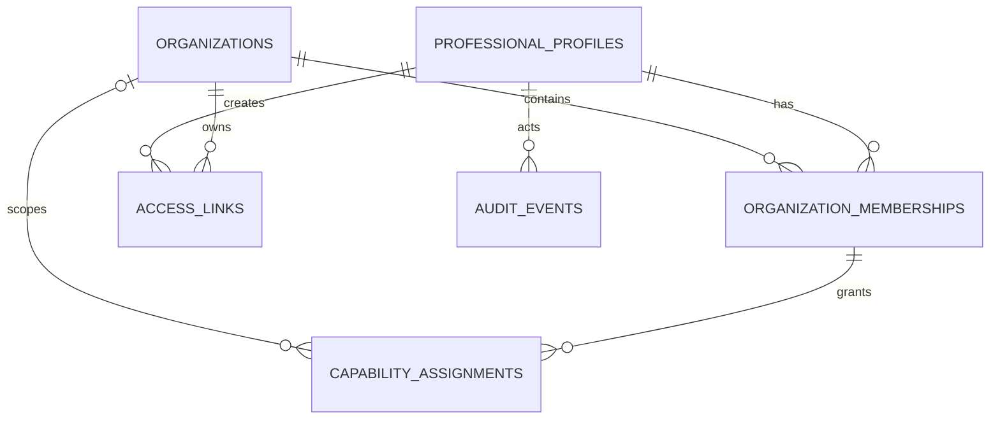

# Current database model

Status: current description of the reconciled persistence model. It follows
[`../current-architecture.md`](../current-architecture.md): one existing GameMaker
experience, portal-managed access links, no portal-composed activities.

The executable application schema is [`prisma/schema.prisma`](../../prisma/schema.prisma)
and the baseline migration is
[`prisma/migrations/0_init/migration.sql`](../../prisma/migrations/0_init/migration.sql).
Nothing is deployed yet, so the baseline replaces the earlier multi-activity model
without keeping legacy tables.

## Schema ownership

```text
PostgreSQL
├── public (application-owned; Prisma migrations)
└── neon_auth (provider-owned; never modified by application migrations)
```

`professional_profiles.auth_user_id` is the only application reference to the Neon
Auth user identity. Professional email addresses and credentials stay in Neon Auth;
`professional_profiles` intentionally has no email column and there is no
cross-schema foreign key, because the identity provider owns its lifecycle and a
future provider must remain replaceable.

Neon Postgres and Neon Auth are the selected V1 implementations. Runtime application
queries use Neon Postgres through Prisma and `@prisma/adapter-neon`; professional
authentication uses the official `@neondatabase/auth` Next.js SDK.

## Tables



| Table | Purpose and key constraints |
| --- | --- |
| `professional_profiles` | Portal state keyed to unique external `auth_user_id`; no email column. Deactivation (`status = inactive`) preserves owned links and audit history. |
| `organizations` | Minimal school/municipal scope without assuming a hierarchy; `type` remains controlled application data. Indexed by `status`. |
| `organization_memberships` | One membership per professional/organization pair (unique). A grant requires an active profile and an active membership. Both foreign keys restrict deletes. |
| `capability_assignments` | Capability grant through a membership. Nullable `scope_organization_id` means platform-wide and is limited to administrators. |
| `access_links` | One customized opaque link per row, scoped to an organization and attributed to a creator. Only the SHA-256 token digest is stored. |
| `audit_events` | Append-only administrative history with controlled before/after state, reason, actor, and correlation ID. |
| `rate_limit_buckets` | Expiring cross-instance fixed-window counts keyed by an HMAC of actor/credential and route scope; contains no raw credential or device identity. |

## Access and organization

Authorization uses the `capability` enum with the six current values:

| Capability | Meaning |
| --- | --- |
| `link:view` | See access links within the authorized scope. |
| `link:manage` | Create, revoke, and rotate access links within the authorized scope. |
| `results:view_organization` | See aggregate results for the scoped organization. |
| `organization:manage` | Manage organization records. |
| `user:manage` | Invite, activate, deactivate members and change memberships/capabilities. |
| `audit:view` | Read the audit history. |

A non-null `scope_organization_id` grants access only within that organization. A null
scope means platform-wide and is reserved for platform administrators. V1 does not
infer parent/child organization access.

Because standard PostgreSQL uniqueness treats null values as distinct, the
`@@unique([membershipId, capability, scopeOrganizationId])` that Prisma would
generate cannot express the intended invariant (two platform-wide grants for the
same membership and capability would not collide). Prisma 7.9 has no
`NULLS NOT DISTINCT` option for `@@unique`, so the schema omits the attribute and
the baseline migration adds the unique index as raw SQL:

```sql
CREATE UNIQUE INDEX "capability_assignments_membership_capability_scope_key"
ON "capability_assignments"("membership_id", "capability", "scope_organization_id")
NULLS NOT DISTINCT;
```

## Access links

`access_links` is the core new table. It records every customized link that can
carry a participant into the single GameMaker experience.

| Column | Type | Rules |
| --- | --- | --- |
| `id` | `uuid` pk | |
| `organization_id` | `uuid` → `organizations` | `ON DELETE RESTRICT`; the owning scope of the link. |
| `created_by_id` | `uuid` → `professional_profiles` | `ON DELETE RESTRICT`; attribution is preserved even after the creator is deactivated. |
| `label` | `varchar(200)` | Management label shown in the portal, for example "Turma 5B". |
| `audience` | `varchar(200)` | Distribution context description, for example "Turma 5B · EMEF Victor Agens". |
| `token_hash` | `char(64)` unique | Lowercase hex SHA-256 digest of the raw opaque token. |
| `expires_at` | `timestamptz(3)` null | Null means no expiry (the default). Must be after `created_at`. |
| `revoked_at` | `timestamptz(3)` null | Null means not revoked. Must not predate `created_at`. |
| `created_at` / `updated_at` | `timestamptz(3)` | Standard timestamps. |

Indexes: unique on `token_hash`; `(organization_id, revoked_at)` for per-organization
listings split by revocation state; `(expires_at)` for expiry sweeps.

### Token-hash storage rule

The raw token exists only in the one-time create/rotate response and in the URL the
professional shares. The database stores only the 64-character lowercase hex SHA-256
digest; a regex CHECK enforces that shape at the storage boundary. Raw tokens are
never logged. Public link validation looks the row up by hashing the presented token,
never by storing or comparing plaintext.

### Lifecycle

- Creation stores a new high-entropy token digest; the raw token is returned exactly
  once.
- Revocation sets `revoked_at`; it never deletes the row, so history and audit remain
  reproducible.
- Rotation creates a new row and revokes the old row in one transaction. There is
  deliberately no `replaces_id` column; if lineage reporting is needed later, it can
  be derived from audit events rather than widening the table now.
- Both `expires_at` and `revoked_at` may be set, and a link may be revoked after it
  has expired. Only the relationship of each timestamp to `created_at` is an
  invariant; the order between `revoked_at` and `expires_at` is not constrained.

## Audit events

`audit_events` is append-only. `correlation_id` is `varchar(64)` because correlation
IDs are lowercase UUID strings (36 characters) produced or accepted by the request
correlation middleware, not UUID columns. Actor is nullable for system-initiated
events; when present it references `professional_profiles` with `ON DELETE
RESTRICT` so audit history never loses attribution.

Indexes `(entity_type, entity_id, occurred_at)`, `(actor_id, occurred_at)`, and
`(occurred_at)` support the entity timeline, actor timeline, and chronological
queries.

## Rate limiting

`rate_limit_buckets` keeps application rate limits correct across instances without
Redis. `bucket_key` is the primary key: a 64-character hex HMAC of an actor or scoped
credential plus route scope. Raw tokens, IP addresses, and device identity are never
stored. Buckets are operational data; expired rows are removed by a bounded cleanup
job.

## Invariants and SQL checks

The baseline migration appends raw CHECK constraints Prisma cannot express:

| Constraint | Table | Rule |
| --- | --- | --- |
| `capability_assignments_membership_capability_scope_key` | `capability_assignments` | Unique `(membership_id, capability, scope_organization_id)` with `NULLS NOT DISTINCT`. |
| `access_links_token_hash_format_check` | `access_links` | `token_hash ~ '^[0-9a-f]{64}$'`. |
| `access_links_expires_at_after_created_at_check` | `access_links` | `expires_at IS NULL OR expires_at > created_at`. |
| `access_links_revoked_at_not_before_created_at_check` | `access_links` | `revoked_at IS NULL OR revoked_at >= created_at`. |
| `rate_limit_buckets_request_count_nonnegative_check` | `rate_limit_buckets` | `request_count >= 0`. |
| `rate_limit_buckets_expires_at_after_window_start_check` | `rate_limit_buckets` | `expires_at > window_started_at`. |

A cross-check between `revoked_at` and `expires_at` was deliberately not added:
revoking a link before its expiry and recording revocation of an already-expired
link are both coherent states, so their relative order is not an invariant.

## Deferred models

Play sessions, attempts, and results are intentionally deferred to the
game-integration workstream. The exact GameMaker result contract is an open
production decision (see the open decisions in
[`../implementation/README.md`](../implementation/README.md)), so modeling those
tables now would guess at the integration payload. When that workstream starts,
session and result tables are added as new migrations against this baseline.

## Deletion policy

Profiles, organizations, access links, and audit events use restrictive foreign
keys, so nothing referenced by history can be deleted accidentally. Deactivation
(`status = inactive`, `revoked_at`) is the operational path; production retention
uses an ordered, batched job after policy approval and never relies on cascade
deletion. Expired rate-limit buckets are the only routinely deleted rows.

## Legacy model (superseded)

The earlier model modeled portal-composed modules, games, activities, drafts,
versions, play sessions, attempts, and results. It was replaced wholesale by the
baseline migration; no legacy tables were carried over. For historical research
only, the old design is described in:

- [`portal-v1-specification.md`](../../portal-v1-specification.md) — the historical
  product specification.
- [`phase-01-foundation-contracts.md`](../implementation/phase-01-foundation-contracts.md),
  [`phase-02-activity-configuration.md`](../implementation/phase-02-activity-configuration.md),
  [`phase-03-game-integration.md`](../implementation/phase-03-game-integration.md),
  and [`phase-04-reporting-hardening.md`](../implementation/phase-04-reporting-hardening.md)
  — the earlier detailed phase plans.

Their token-security, authorization, audit, and idempotency principles were carried
into this model; their catalogue, activity-composition, and versioning tables were
not. Do not treat them as current requirements.
