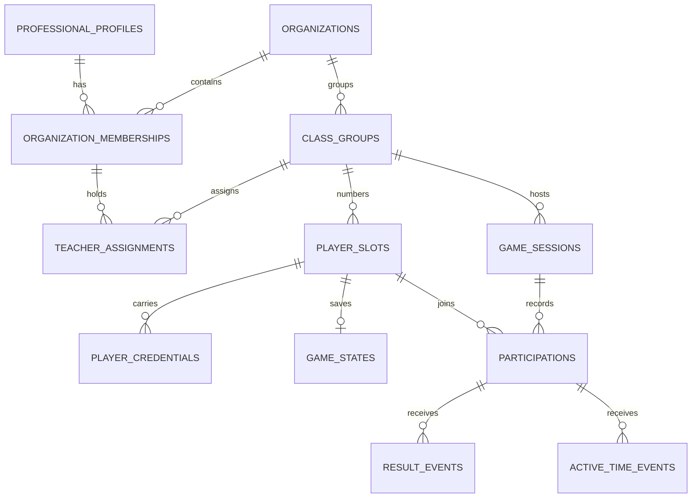

# Current database model

Status: current description of the reconciled persistence model. It follows
[`../current-architecture.md`](../current-architecture.md): one existing GameMaker
experience, numbered player access through rotatable QR credentials, and no
portal-composed activities.

The executable application schema is [`prisma/schema.prisma`](../../prisma/schema.prisma)
and the baseline migration is
[`prisma/migrations/0_init/migration.sql`](../../prisma/migrations/0_init/migration.sql).
Migration history is a single post-refactor baseline: `0_init` creates the entire
surviving schema in one step, and the earlier incremental migrations were replaced
rather than kept.

## Schema ownership

```text
PostgreSQL
├── public (application-owned; Prisma migrations)
└── neon_auth (provider-owned; never modified by application migrations)
```

`professional_profiles.auth_user_id` is the only application reference to the Neon
Auth user identity. Professional email addresses and credentials stay in Neon Auth;
`professional_profiles` intentionally has no email column and there is no
cross-schema foreign key, because the identity provider owns its lifecycle and a
future provider must remain replaceable.

Neon Postgres and Neon Auth are the selected V1 implementations. Runtime application
queries use Neon Postgres through Prisma and `@prisma/adapter-neon`; professional
authentication uses the official `@neondatabase/auth` Next.js SDK.

## Tables



| Table | Purpose and key constraints |
| --- | --- |
| `professional_profiles` | Portal identity keyed to unique external `auth_user_id`; no email column. Optional `platform_role` marks platform administrators. Deactivation (`status = inactive`) preserves owned memberships and history. |
| `organizations` | Minimal school/municipal scope without assuming a hierarchy; `type` remains controlled application data. Indexed by `status`. |
| `organization_memberships` | One membership per professional/organization pair (unique). Role is `organization_admin` or `teacher`. Both foreign keys restrict deletes; indexed by `(organization_id, status)`. |
| `class_groups` | Class scope inside an organization, without a nominal student roster; `next_player_number` supports sequential slot numbering. Indexed by `(organization_id, status)`. |
| `player_slots` | Numbered players within a class: `(class_group_id, player_number)` is unique, and no child name, email, or password is stored. Indexed by `(class_group_id, status)`. |
| `player_credentials` | Rotatable bearer credential for a slot; only the SHA-256 `token_hash` is stored. At most one `active` credential per slot (partial unique index). |
| `game_sessions` | Class session lifecycle (`active`/`ended`, `started_at`, `ended_at`); at most one active session per class group (partial unique index). |
| `participations` | Idempotent join between a session and a player slot: unique `(game_session_id, player_slot_id)`; indexed by `(player_slot_id, joined_at)`. |
| `game_states` | One versioned state document per slot (the primary key is `player_slot_id`): `protocol_version`, `schema_version`, `content_version`, JSONB `payload`, monotonic `revision`. |
| `result_events` | Ingested results keyed to a participation and deduplicated by unique `client_event_id`; carries request/activity/mission/attempt identifiers, `result_state`, `duration_ms`, and JSONB `metrics`/`payload`. Indexed by participation and activity timelines. |
| `active_time_events` | Ingested active-play time keyed to a participation and deduplicated by unique `client_event_id`; carries `active_ms` and `mode`. Indexed by the participation timeline. |
| `teacher_assignments` | Ties a membership to a class group it works with; unique per membership/class pair. Indexed by `(class_group_id, status)`. |

## Enums

| Enum | Values | Used by |
| --- | --- | --- |
| `record_status` | `active`, `inactive`, `archived` | Shared lifecycle status on most tables. |
| `platform_role` | `platform_admin` | `professional_profiles.platform_role` (nullable). |
| `organization_role` | `organization_admin`, `teacher` | `organization_memberships.role`. |
| `player_credential_status` | `active`, `revoked` | `player_credentials.status`. |
| `game_session_status` | `active`, `ended` | `game_sessions.status`. |

## Roles and organization

Authorization is role-based. `professional_profiles.platform_role` marks platform
administrators, and `organization_memberships.role` distinguishes
`organization_admin` from `teacher` within one organization. `teacher_assignments`
binds a membership to the individual class groups it works with, so class-level
responsibility is explicit data rather than an inference from role. The
responsibilities of the three adult levels are defined in
[`../current-architecture.md`](../current-architecture.md).

## Classes, players, and credentials

A class group is an organization-scoped class without a nominal student roster.
`player_slots` records the numbered players themselves: the visible number is unique
per class and is never a global student identity. A slot is an anonymous numbered
seat — no child name, email, or password is stored — and it owns rotatable
credentials plus the accumulated participations, game state, and events.

### Player credentials

`player_credentials` stores the rotatable bearer credentials a slot can enter with:

| Column | Type | Rules |
| --- | --- | --- |
| `id` | `uuid` pk | |
| `player_slot_id` | `uuid` → `player_slots` | `ON DELETE RESTRICT`. |
| `token_hash` | `char(64)` unique | Lowercase hex SHA-256 digest of the raw opaque token. |
| `status` | `player_credential_status` | `active` or `revoked`. |
| `created_at` | `timestamptz(3)` | Standard timestamp. |
| `revoked_at` | `timestamptz(3)` null | Null means not revoked. |

Indexes: unique on `token_hash`; `(player_slot_id, status)` for per-slot lookups;
and a partial unique index on `player_slot_id` where `status = 'active'` (listed
among the rules below), which allows at most one active credential per slot.

### Token-hash storage rule

The raw token exists only in the one-time issue/rotate response and in the QR code
the teacher distributes. The database stores only the 64-character lowercase hex
SHA-256 digest. Raw tokens are never logged. Player entry validates by hashing the
presented token and looking the digest up, never by storing or comparing plaintext.

### Lifecycle

- Issuing a credential stores a new high-entropy token digest; the raw token is
  returned exactly once.
- Revocation sets `status = revoked` and `revoked_at`; it never deletes the row.
- Rotation issues a new credential row and revokes the previous one; the partial
  unique index guarantees at most one active credential per slot at any time.

## Sessions, participation, and game events

`game_sessions` records class sessions: at most one `active` session exists per
class group, and ending a session sets `status = ended` and `ended_at`.
`participations` is the idempotent join between a session and a slot — unique
`(game_session_id, player_slot_id)` — so re-entering the same session resolves to
the existing participation instead of a duplicate.

`game_states` holds one versioned state document per slot. The primary key is the
`player_slot_id` itself, and each row carries `protocol_version`, `schema_version`,
`content_version`, a JSONB `payload`, and a monotonic `revision`.

`result_events` and `active_time_events` are the ingested game-event streams. Both
key to a participation and deduplicate on a unique `client_event_id`, so retried
submissions cannot double-count. Result rows carry request, activity, mission, and
attempt identifiers plus `result_state`, `duration_ms`, and JSONB `metrics` and
`payload`; active-time rows carry `active_ms` and `mode`. The domains for
`result_state`, `duration_ms`, `active_ms`, and `mode` are enforced by the database
rules below. Both tables index `(participation_id, received_at)`, and results
additionally index `(activity_id, received_at)` for per-activity reporting.

## Invariants and SQL checks

The baseline migration appends ten named database rules that the Prisma schema
language cannot express:

| Rule | Table | Predicate |
| --- | --- | --- |
| `player_slots_player_number_positive` | `player_slots` | `player_number > 0`. |
| `game_states_revision_check` | `game_states` | `revision > 0`. |
| `game_states_protocol_version_check` | `game_states` | `protocol_version = 1`. |
| `game_states_schema_version_check` | `game_states` | `schema_version = 1`. |
| `result_events_duration_ms_check` | `result_events` | `duration_ms >= 0`. |
| `result_events_result_state_check` | `result_events` | `result_state IN ('sucesso', 'falha', 'cancelado', 'tempo_esgotado', 'erro_inicializacao')`. |
| `active_time_events_active_ms_check` | `active_time_events` | `active_ms BETWEEN 1 AND 30000`. |
| `active_time_events_mode_check` | `active_time_events` | `mode IN ('exploration', 'dialogue', 'activity')`. |
| `player_credentials_one_active_per_slot` | `player_credentials` | Unique index on `player_slot_id` where `status = 'active'`. |
| `game_sessions_one_active_per_class` | `game_sessions` | Unique index on `class_group_id` where `status = 'active'`. |

Structural uniqueness invariants — one membership per professional/organization
pair, one player number per class, one participation per session/slot pair, one
teacher assignment per membership/class pair, and the unique `auth_user_id` and
`token_hash` values — are ordinary Prisma `@@unique` indexes, so they need no
hand-written SQL.

## Deletion policy

Every foreign key is `ON DELETE RESTRICT`, so nothing referenced by another row can
be deleted accidentally. Deactivation is the operational path: profiles,
organizations, memberships, class groups, player slots, and teacher assignments use
`status = inactive`; credentials use `status = revoked` with `revoked_at`; and
sessions use `status = ended` with `ended_at`. Production retention uses an
ordered, batched job after policy approval and never relies on cascade deletion.

## Legacy model (superseded)

The earlier model modeled portal-composed modules, games, activities, drafts,
versions, play sessions, attempts, and results. It was replaced wholesale by the
post-refactor baseline migration; no legacy tables were carried over. For
historical research only, the old design is described in:

- [`portal-v1-specification.md`](../../portal-v1-specification.md) — the historical
  product specification.
- [`phase-01-foundation-contracts.md`](../implementation/phase-01-foundation-contracts.md),
  [`phase-02-activity-configuration.md`](../implementation/phase-02-activity-configuration.md),
  [`phase-03-game-integration.md`](../implementation/phase-03-game-integration.md),
  and [`phase-04-reporting-hardening.md`](../implementation/phase-04-reporting-hardening.md)
  — the earlier detailed phase plans.

Their token-security and idempotency principles were carried into this model; their
catalogue, activity-composition, and versioning tables were not. Do not treat them
as current requirements.
