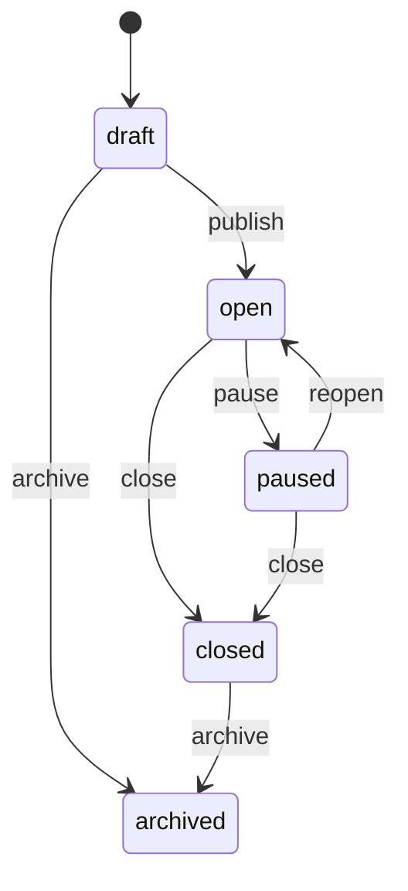

# Legacy Portal V1 domain rules

> **Not current product authority.** This document models portal-composed activities,
> modules, and selected games. The current product has one existing GameMaker
> experience and portal-managed access links. Retain the token, privacy, authorization,
> idempotency, and audit principles, but redesign the domain model against
> [`../current-architecture.md`](../current-architecture.md) before implementation.

This document defines invariants that must be shared by route handlers, server-rendered
pages, jobs, and tests. Business rules belong in domain services, not in UI components
or repository methods.

## State machines

### Activity



- `publish` creates an immutable version, its game rows, and the first activity link
  in one transaction, then moves the activity to `open`.
- Publishing a revised draft creates the next version and atomically updates
  `current_version_id`. Existing play sessions stay bound to their original version.
- First publication requires `active` module and selected games. A revision may retain
  an existing module/game identity in `new_activities_blocked`, but may not newly add a
  catalogue identity in that mode.
- `closed` and `archived` are terminal for public launch in V1.
- Pausing, closing, archiving, reopening, and publishing are audited.

### Play session and attempt

```text
play session: active -> completed | expired
attempt:       issued -> completed | expired
```

- A play session is permanently bound to one activity version.
- `sequencia_tentativa` is the ordinal for retries of the same game within a play
  session. `numero_tentativa_atividade` is the ordinal across all attempts in that play
  session. Both are allocated and validated by the server.
- Session and attempt expiry is enforced lazily on every credentialed access and the
  observed state is persisted atomically. Scheduled sweeps are cleanup, not the source
  of correctness.
- An accepted attempt remains allowed to submit its result after a later availability
  block, provided its token is valid and the attempt has not expired.
- An attempt accepts at most one distinct result. Repeating the same
  `(attempt_id, client_event_id)` returns the stored acknowledgement; a different event
  for a completed attempt returns `ATTEMPT_ALREADY_COMPLETED`.

## Availability resolution

Evaluate launchability on the server both when producing a manifest and immediately
before issuing an attempt. All conditions must be true:

```text
activity.status == open
activity link is present, unexpired, and not revoked
module.availability_mode permits launches
game appears enabled in the bound activity version
no activity-level launch block exists for the game
game.availability_mode permits launches
game version is published and supported by the runtime
```

`active` and `new_activities_blocked` permit launches. `launches_blocked` and
`archived` do not. An activity's first publication additionally requires both the
module and every selected game to be `active`. A later revision may keep an existing
module/game identity in `new_activities_blocked`; it cannot introduce one that was not
in the current activity version.

Availability changes never modify published version rows or accepted results.

## Activity links

- New and rotated links are non-expiring by default (`expires_at = null`). The activity
  publisher or authorized administrator may set/clear a future expiry at publication,
  rotation, or through the dedicated expiry mutation; every later change is audited.
- Link rotation creates a new high-entropy token and revokes the prior link in one
  transaction. The raw replacement token is returned exactly once.
- Link validity remains part of manifest and attempt authorization after session
  creation. Revoking, rotating, or expiring an originating link therefore blocks new
  manifests and attempts for its active sessions.
- Attempts issued before revocation/rotation/expiry may submit their one valid result
  while their attempt credential remains valid. They may not launch another attempt.
- The professional UI warns about active-session impact before revoke or rotation.
- Public session creation always rechecks `activity.status == open` after validating the
  link and immediately before insert. A paused, closed, or archived activity creates no
  session.

## Catalogue versioning

- A module or game is a stable catalogue identity and owns mutable runtime
  availability.
- Published module and game versions are immutable.
- A module version references exact game versions. An activity version copies those
  references and validated configuration snapshots.
- A schema or runtime change creates a new game version. It never edits the schema
  version associated with historical attempts.
- A module version cannot be published with duplicate game positions, duplicate
  games, an unpublished game version, or `enabled_by_default = false` on a required
  game.

## Draft and publication rules

- Only the owner or an administrator with the appropriate capability may mutate a
  draft.
- Each activity has at most one editable draft, including when preparing a revision.
- Required games must be enabled unless the actor has the administrative override
  capability. Any override is audited.
- Game configuration is validated against the selected game version's configuration
  schema before it is stored and again inside the publication transaction.
- Publication copies draft data into immutable version rows; it does not make the
  draft rows themselves historical records.
- Version numbers are monotonically increasing per activity and allocated in the
  publication transaction.

## Authorization scopes

- Capabilities are assigned through an active organization membership.
- `scope_organization_id = null` means platform-wide scope and is reserved for
  platform administrators.
- A non-null scope grants access only within that organization. V1 does not infer
  parent/child organization access.
- Owners can manage and report on their own activities when they hold the matching
  capability. School viewers require an explicitly scoped results capability.
- Every protected mutation performs authorization inside the service method, even if
  the page or route handler already checked it.
- Only `user:manage` may invite, activate, deactivate, or change memberships and
  capabilities. A manager cannot grant a capability or scope broader than their own;
  platform-wide grants require platform-wide `user:manage`.

## Request protection and rate limiting

- Every cookie-authenticated mutation validates origin and CSRF proof in addition to
  authentication and authorization. `GET` requests never mutate state.
- Application rate limits use expiring PostgreSQL fixed-window buckets so they remain
  effective across instances without Redis. Bucket keys are HMACs of an actor or scoped
  credential plus route; raw tokens, IP addresses, and device identity are not stored.
- Hosting ingress may add a transient IP burst limit, but it is defense in depth rather
  than application correctness.
- Public session creation, attempt creation, and result submission are rate limited.
  Professional sign-in and administrative mutations use conservative actor-scoped
  limits and return `429` with `Retry-After`.

## Privacy and retention

- `anonymous_key` is random session correlation data. It must never be derived from a
  name, email, enrollment number, IP address, or device fingerprint.
- Request logs redact raw tokens and result payloads. Audit events contain application
  identifiers and controlled reasons, not secrets.
- Retention deletes or anonymizes public runtime data according to configuration;
  professional profiles and immutable audit records follow the separately approved
  administrative policy.
- Aggregate reports are derived only from accepted `attempt_results` and must be
  reproducible.
