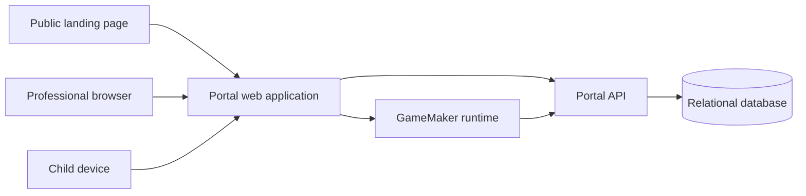

# Missoes do Caramelito Portal V1 Proposal (Historical)

> **Status: superseded in part for current product scope.** The authenticated
> professional/admin portal remains a supported surface, but there is no institutional
> or marketing landing page. Participants enter gameplay only through customized opaque
> links; the portal must not launch or help participants discover gameplay. The current
> product integrates one existing GameMaker experience rather than creating multiple
> portal-configured games, modules, or minigame catalogs. Sections below that require a
> landing page, portal-authored game composition, or portal-launched participant play
> are historical and are not authoritative. The current boundary is documented in
> [`docs/current-architecture.md`](docs/current-architecture.md).

Status: Historical proposal; not the current product source of truth

Audience: Product, engineering, pedagogy, municipal management, and project leadership

Source: Initial digital platform proposal and the current GameMaker prototype

## 1. Purpose

This document records a low-rework first version of the access portal proposal for Missoes do Caramelito. It turns the earlier proposal into an implementation reference without treating undecided subjects as approved requirements or overriding the current product boundary stated above.

The historical proposal connected three areas:

1. A public institutional landing page.
2. An authenticated portal where professionals configure and share activities.
3. The game runtime, which receives the configuration for an activity and sends aggregate results back to the portal.

The historical proposal asked the portal to let authorized professionals control:

- Whether a module is available.
- Whether a game is available globally.
- Which games are enabled for a specific activity being created.
- Whether an existing activity is open, paused, or closed.
- Whether a game must stop accepting new launches, without deleting historical results.

## 2. Decision Status

The source proposal is a recommendation, not a record of final approvals. V1 therefore adopts defaults that minimize personal data and operational complexity while keeping extension points for later decisions.

### 2.1 V1 defaults

| Subject                  | V1 default                          | Reason                                                           |
| ------------------------ | ----------------------------------- | ---------------------------------------------------------------- |
| Professional access      | Authenticated adult account         | Required to create activities and view results                   |
| Child access             | Exclusive activity link, no account | Lowest access and privacy complexity                             |
| Results                  | Aggregate by activity and game      | Supports pedagogical discussion without child profiles           |
| Child identity           | Not collected                       | Avoids individual tracking before its purpose is approved        |
| Family accounts          | Not included                        | No confirmed private family experience requires them             |
| Responses                | Predefined choices and game metrics | Avoids moderation and sensitive free text                        |
| Permissions              | Small capability-based set          | Avoids hardcoding an unconfirmed organization chart              |
| Module and game controls | Included                            | Required for safe staged publication and activity configuration  |
| Data retention           | Configurable, final period pending  | Implementation can proceed, but production policy needs approval |

### 2.2 Terms

Use these terms consistently to avoid ambiguity:

- **Module**: a pedagogical package containing one or more games and activities around a theme.
- **Game**: an executable game or minigame registered in the game build.
- **Activity**: configuration created by a professional and shared through one exclusive link.
- **Activity version**: immutable snapshot of the selected module, games, parameters, and content.
- **Play session**: one anonymous participant run started from an activity link.
- **Attempt**: one execution of one game inside a play session.
- **Professional session**: authenticated web session for an adult user. This is not a play session.

## 3. Product Scope

### 3.1 Included in V1

- Professional sign-in and sign-out.
- Module catalogue visible according to availability and permission.
- Game catalogue for administrators.
- Creation of an activity from one published module version.
- Selection of games enabled for that activity.
- Per-game configuration within validated limits, such as difficulty and duration.
- Activity preview before publication.
- Publication through an opaque exclusive link and QR code.
- Activity states: draft, open, paused, closed, and archived.
- Anonymous child access without account creation.
- Game launch manifest generated by the portal.
- Structured game result ingestion with idempotency.
- Aggregate activity results.
- Global and per-activity game availability controls.
- Basic audit trail for sensitive administrative changes.

### 3.2 Explicitly outside V1

- Child accounts or profiles.
- Family accounts.
- Individual child history or reports.
- Proof that a specific child participated.
- Free-text answers from children.
- Private messaging between professionals and families.
- Automatic interventions based on individual behavior.
- Complex organization hierarchies or many fixed job titles.
- Full content authoring inside the portal.
- Real-time termination of a game already running on a device.
- Mandatory comparison between classes or schools.

## 4. Roles and Capabilities

V1 must authorize capabilities, not depend directly on role names. Role labels can change later without rewriting authorization rules.

| Capability                            | Activity creator | School viewer | Platform administrator |
| ------------------------------------- | ---------------: | ------------: | ---------------------: |
| View available modules                |              Yes |           Yes |                    Yes |
| Create an activity                    |              Yes |      Optional |                    Yes |
| Edit own draft activity               |              Yes |            No |                    Yes |
| Publish, pause, or close own activity |              Yes |            No |                    Yes |
| Select games for own activity         |              Yes |            No |                    Yes |
| View results from own activity        |              Yes |      Optional |                    Yes |
| View results scoped to a school       |               No |           Yes |                    Yes |
| Activate or disable a module globally |               No |            No |                    Yes |
| Activate or disable a game globally   |               No |            No |                    Yes |
| Release sensitive modules             |               No |            No |              Yes in V1 |
| Manage users and permissions          |               No |            No |                    Yes |

The mapping between real municipal responsibilities and these capabilities remains configurable.

## 5. Main User Flows

### 5.1 Professional creates an activity

1. The professional signs in.
2. The portal lists module versions available for new activities.
3. The professional chooses a module.
4. The portal displays the games connected to that module.
5. Games enabled by default are preselected.
6. The professional may disable optional games for this activity.
7. Required games cannot be disabled unless the user has an administrative override capability.
8. The professional reviews the activity and publishes it.
9. The portal creates an immutable activity version and an opaque access link.
10. The professional shares the link or QR code.

### 5.2 Child starts an activity

1. The child opens the exclusive activity link.
2. The portal validates that the link and activity are available.
3. The portal creates an anonymous play session.
4. The game receives a short-lived launch token and a server-generated manifest.
5. Only games allowed by the activity version and current availability rules are shown.
6. Before each game attempt, the server validates that the game can still launch.
7. The game sends its structured result after completion.
8. The portal acknowledges the result once and updates aggregate data.

### 5.3 Professional views results

1. The professional opens an activity they are authorized to view.
2. The portal shows participation count, completion count, completion rate, predefined choice distribution, and supported per-game metrics.
3. No child name, profile, or inferred identity is displayed.

## 6. Module and Game Availability

Availability is separate from content versioning. Historical records must remain readable even after a module or game is disabled.

### 6.1 Availability modes

Modules and games support the following runtime modes:

| Mode                     | New activities |               New play sessions | New attempts in existing sessions |            Historical results |
| ------------------------ | -------------: | ------------------------------: | --------------------------------: | ----------------------------: |
| `active`                 |        Allowed |                         Allowed |                           Allowed |                     Available |
| `new_activities_blocked` |        Blocked | Allowed for existing activities |                           Allowed |                     Available |
| `launches_blocked`       |        Blocked |           Blocked when affected |                           Blocked |                     Available |
| `archived`               |        Blocked |                         Blocked |                           Blocked | Available to authorized users |

`launches_blocked` is the V1 kill switch. It prevents new launches but does not attempt to terminate code already running on a device. An already accepted attempt may submit its final result.

### 6.2 Per-activity game selection

Each activity version contains an explicit list of enabled games. A game is launchable only when all of the following are true:

```text
activity.status == open
AND activity_link is valid
AND module runtime mode permits launches
AND game belongs to the activity version
AND game is enabled for the activity
AND game runtime mode permits launches
AND the server can issue a valid attempt token
```

The client must never decide availability by itself. It may hide unavailable games for user experience, but the server remains authoritative.

### 6.3 Changing a published activity

- Content or parameter changes create a new immutable activity version.
- Disabling a game for one published activity creates a logged runtime override and blocks new attempts for that game.
- Existing results remain linked to the activity version and game version that produced them.
- Re-enabling a game removes the runtime override only if the module and game are still globally launchable.
- Closing an activity blocks new play sessions and attempts but preserves results.

### 6.4 Global emergency control

Administrators can set a game or module to `launches_blocked`. This must:

- Take effect on the next server launch validation.
- Remove the item from new manifests.
- Reject new attempts with a stable machine-readable reason.
- Preserve already stored activity versions and results.
- Write an audit event with actor, timestamp, reason, and previous value.

V1 does not promise immediate interruption of an already running minigame. If that becomes necessary, a later version can add polling or push notifications and a safe in-game shutdown boundary.

## 7. Recommended Architecture

The current landing page remains a static application. The authenticated portal and public activity runtime require a server-side application and database.



Recommended boundaries:

- **Landing**: public institutional information only.
- **Portal UI**: professional screens and public activity entry screen.
- **Portal API**: authentication, authorization, activity configuration, availability resolution, attempt creation, and results.
- **Database**: versioned catalogue, activities, anonymous play sessions, attempts, results, and audit events.
- **Game adapter**: GameMaker code that translates portal manifests into the existing minigame context and sends results back.

The API contract must be independent of the final hosting and authentication vendors.

### 7.1 Recommended implementation stack

Use a TypeScript modular monolith for V1 rather than separate frontend and backend applications.

| Area                       | Recommendation                                | Notes                                                                                     |
| -------------------------- | --------------------------------------------- | ----------------------------------------------------------------------------------------- |
| Web framework              | Next.js 16 App Router                         | One application for landing, portal, public activity entry, and API                       |
| UI runtime                 | React 19.2                                    | Use Server Components by default and Client Components only for real interaction          |
| Language                   | TypeScript 5.x in strict mode                 | Shared types across UI, domain services, validation, and API tests                        |
| Runtime                    | Node.js 24 LTS                                | Pin in the repository and production container                                            |
| Database                   | Neon Postgres                                 | Use the Free plan for development and a limited pilot, with an explicit upgrade threshold |
| ORM and migrations         | Prisma ORM 7 with `@prisma/adapter-neon`      | Type-safe client, Neon serverless driver, and checked-in migrations                       |
| Authentication             | Neon Auth                                     | Managed auth powered by Better Auth; provision professionals only                         |
| Runtime validation         | Zod 4                                         | Validate environment variables, forms, manifests, attempt contexts, and result payloads   |
| Styling                    | CSS Modules plus shared CSS custom properties | Reuse the current visual language without rewriting it into utility classes               |
| Unit and integration tests | Vitest                                        | Domain rules, availability resolution, authorization, and API contracts                   |
| Browser tests              | Playwright                                    | Landing parity, professional flows, public activity flows, and accessibility checks       |
| Deployment                 | Dockerized Node.js application plus Neon      | The web host remains independent from the database and auth provider                      |

Pin exact dependency versions in the lockfile. Upgrade deliberately through tested pull requests rather than using floating production versions.

### 7.2 Why this stack

- Next.js can statically render the public landing while also serving authenticated pages and versioned Route Handler APIs.
- React removes the need for SolidJS and has a larger hiring, maintenance, and accessibility ecosystem.
- One web framework avoids duplicating navigation, design tokens, authentication state, deployment, and observability.
- Neon provides managed PostgreSQL, scale to zero, connection pooling, and database branching without changing the application data model.
- Prisma makes the relational model and migration history visible to a small TypeScript team. Use raw SQL where aggregate reporting requires it.
- Neon Auth stores professional users and sessions in the database and is based on Better Auth. Domain authorization remains behind an application-owned service boundary because Neon Auth is managed and is not a drop-in replacement for self-hosted Better Auth.
- REST and versioned JSON are easier for GameMaker to consume than GraphQL, server-only actions, or framework-specific RPC.
- A modular monolith is simpler to operate than microservices and can still be separated later because domain services and game contracts have explicit boundaries.

### 7.3 Application structure

Create a new platform repository instead of expanding the current nested `SMS_Landing` repository or placing backend code inside the GameMaker project.

Suggested repository name:

```text
missoes-caramelito-platform
```

Suggested initial structure:

```text
src/
  app/
    (marketing)/
      page.tsx
    (professional)/
      entrar/page.tsx
      portal/
        page.tsx
        modulos/page.tsx
        atividades/
    (public-play)/
      atividade/[token]/page.tsx
    api/v1/
      modules/
      activities/
      play-sessions/
      attempts/
  components/
    marketing/
    portal/
    shared/
  server/
    auth/
    db/
    domain/
    repositories/
    services/
  contracts/
    schemas/
    fixtures/
prisma/
  schema.prisma
  migrations/
public/
  assets/
tests/
  unit/
  integration/
  e2e/
```

Business rules belong in `server/domain` and `server/services`, not in React components, Server Actions, or API route files. Server Components and Route Handlers call the same application services.

Keep the GameMaker project in its own repository and release cycle. Exchange only versioned JSON schemas, fixtures, and integration documentation between the platform and game repositories. This keeps large game assets and GameMaker build configuration out of the web deployment.

### 7.4 API and rendering rules

- Use Server Components for landing sections, dashboards, catalogues, and result pages that do not require browser state.
- Use Client Components for forms with immediate interaction, game selectors, dialogs, and the animated mascot.
- Use Route Handlers under `/api/v1` for every endpoint consumed by GameMaker or another external client.
- Internal server-rendered pages call application services directly rather than making HTTP requests back to their own API.
- All mutations pass through the same authorization and validation services, regardless of whether they originate in a web form or API request.
- Use the Node.js runtime for database and authentication routes. Do not make V1 depend on edge-runtime limitations.
- Do not add GraphQL, Redux, Redis, a message broker, or microservices without a demonstrated requirement.

### 7.5 Authentication baseline

Use Neon Auth through the official Next.js SDK. Neon Auth is powered by Better Auth, but Neon operates its server-side layer and stores authentication data in the dedicated `neon_auth` schema.

V1 configuration rules:

- Disable public registration.
- Provision the first administrator through a controlled deployment command.
- Let administrators invite or activate professional users.
- Store session cookies as `HttpOnly`, `Secure`, and `SameSite=Lax` in production.
- Perform secure authorization checks in the data access and service layer for every protected operation.
- Do not encode the complete capability set only in a long-lived browser token.
- Wrap Neon Auth session access in an application-owned `AuthGateway` interface. A later Keycloak, Microsoft Entra ID, or other OIDC provider must not change domain authorization.
- Store professional capabilities and organization membership in application tables keyed by the Neon Auth user ID. Do not place the complete portal authorization model only in provider roles.
- Game and child play-session tokens remain separate from professional authentication sessions.
- Do not create Neon Auth users for children. Anonymous play sessions use short-lived application tokens issued by the portal API.
- Do not expose Neon Auth administrative APIs or database credentials to GameMaker.

Neon Auth currently requires its official SDK and does not support every custom Better Auth plugin or server handler. Any auth feature beyond sign-in, session management, password recovery, invitations, and supported OAuth/OIDC flows must be validated against Neon Auth before it enters scope.

### 7.6 Database rules

- Use one Neon project for production or pilot data and a separate Neon project for development. Do not create development branches from production data containing real professional accounts.
- Use Neon branches from the development project for preview environments and contract tests.
- Use the pooled `DATABASE_URL` with `@prisma/adapter-neon` for the running application.
- Use a direct `DIRECT_URL` for Prisma migration and administrative workflows when required by the current Prisma and Neon guidance.
- Use relational columns and foreign keys for identity, ownership, state, scope, and reporting dimensions.
- Use `jsonb` only for immutable configuration snapshots, versioned content fragments, and game-specific metrics.
- Never store all domain data in generic JSON documents.
- Generate checked-in Prisma migrations and review their SQL before production deployment.
- Run migrations as a deployment step, not automatically from every application instance at startup.
- Use database transactions for activity publication, attempt creation, result acceptance, and availability changes.
- Add explicit indexes for public token hashes, ownership, activity status, session status, game keys, timestamps, and reporting filters.

Prisma migrations manage only application-owned schemas and tables. Neon manages the `neon_auth` schema. Application migrations must not drop, rename, or recreate Neon Auth tables.

### 7.7 Landing migration recommendation

Port the landing into the new Next.js application instead of maintaining Astro plus SolidJS indefinitely. Do not rewrite it at the same time as the first portal feature.

Use this migration sequence:

1. Create the Next.js platform shell, design tokens, CI, database connection, and health endpoint.
2. Build the first portal route and authentication boundary.
3. Port static landing sections from Astro to React Server Components with matching HTML and CSS.
4. Move current mascot route calculations as framework-neutral TypeScript and retain their existing unit tests.
5. Port only the `MascotGuide` wrapper to a React Client Component.
6. Run visual regression and Playwright checks at desktop and mobile sizes.
7. Keep the Astro deployment available until the Next.js landing reaches content, metadata, accessibility, and visual parity.
8. Switch the public domain to the new application, then archive the old landing repository.

The port should preserve the current design instead of redesigning the landing during the infrastructure migration. A separate redesign can happen after cutover.

### 7.8 Alternatives considered

| Alternative                                          | Decision                             | Reason                                                                                |
| ---------------------------------------------------- | ------------------------------------ | ------------------------------------------------------------------------------------- |
| Keep Astro and replace Solid with vanilla TypeScript | Acceptable temporary option          | Lowest immediate migration cost, but keeps two web stacks after the portal exists     |
| Astro for landing plus Next.js for portal            | Not recommended long term            | Duplicates deployment, components, design tokens, metadata, and maintenance           |
| React single-page application plus separate API      | Not recommended for V1               | Adds a second deployable and loses simple server rendering for the landing and portal |
| Supabase or Firebase as the application architecture | Not recommended as the core boundary | Fast initially, but municipal hosting and identity constraints are not confirmed      |
| Separate microservices                               | Rejected for V1                      | Operational complexity without current scale or team need                             |
| Full rewrite of the GameMaker project                | Rejected                             | The existing context and result interfaces are already usable integration seams       |

### 7.9 Neon Free plan operating profile

The Neon Free plan is suitable for implementation, demonstrations, and a limited pilot. At the time of this document, the published Free plan includes 100 compute unit hours per project each month, 0.5 GB storage per project, 5 GB public network transfer per month, scale to zero, and up to 60,000 Neon Auth monthly active users.

These limits affect the architecture as follows:

- Neon Auth usage should remain small because only professionals authenticate. Child play sessions do not consume authenticated-user records.
- Game builds, sprites, audio, videos, screenshots, and downloadable material must use web static hosting or object storage, not PostgreSQL.
- Store compact structured metrics rather than raw gameplay telemetry or frame-by-frame events.
- Aggregate reports should query indexed relational dimensions instead of repeatedly transferring complete JSON result sets.
- Enable usage alerts and review the Neon dashboard during the pilot.
- Treat scale-to-zero cold starts as acceptable for development and pilot use, then measure the first request and sign-in experience.

Start an upgrade review when any project reaches one of these internal warning thresholds:

- 70 compute unit hours in a month.
- 350 MB of stored data.
- 3.5 GB of public network transfer in a month.
- A requirement for production support, an SLA, longer monitoring retention, private networking, or additional compliance controls.
- A pilot whose availability is operationally important to active schools.

Free-plan limits can change. Confirm the current Neon pricing page before each pilot or production approval.

The platform must keep all database access behind the server application. GameMaker and browser clients call the versioned portal API and never connect directly to Neon Postgres or the Neon Data API.

## 8. Data Model

The following is a logical model, not a vendor-specific SQL schema.

### 8.1 Access and organization

| Entity                     | Important fields                                                  |
| -------------------------- | ----------------------------------------------------------------- |
| `professional_profiles`    | `id`, unique `auth_user_id`, `display_name`, `status`, timestamps |
| `organizations`            | `id`, `name`, `type`, `status`                                    |
| `organization_memberships` | `professional_profile_id`, `organization_id`, `status`            |
| `capability_assignments`   | `membership_id`, `capability`, optional `scope_id`                |

School structures may be represented as organizations or organization scopes until the official hierarchy is approved.

Credentials, password recovery records, provider accounts, and professional login sessions belong to Neon Auth in the `neon_auth` schema. The application profile stores only the identity reference and portal-specific state.

### 8.2 Catalogue

| Entity                 | Important fields                                                                                          |
| ---------------------- | --------------------------------------------------------------------------------------------------------- |
| `modules`              | `id`, `key`, `name`, `availability_mode`, `sensitive`, timestamps                                         |
| `module_versions`      | `id`, `module_id`, `version`, `content_snapshot`, `published_at`                                          |
| `games`                | `id`, `key`, `name`, `availability_mode`, `runtime_key`, `config_schema_version`, `result_schema_version` |
| `module_version_games` | `module_version_id`, `game_id`, `position`, `required`, `enabled_by_default`, `default_config`            |

Module versions are immutable after publication. Runtime availability stays on `modules` and `games` so an administrator can block launches without altering history.

### 8.3 Activities and public access

| Entity                    | Important fields                                                                               |
| ------------------------- | ---------------------------------------------------------------------------------------------- |
| `activities`              | `id`, `owner_id`, `organization_id`, `status`, `current_version_id`, open and close timestamps |
| `activity_versions`       | `id`, `activity_id`, `version`, `module_version_id`, `configuration_snapshot`, `published_at`  |
| `activity_version_games`  | `activity_version_id`, `game_id`, `enabled`, `position`, `configuration_snapshot`              |
| `activity_game_overrides` | `activity_id`, `game_id`, `launches_blocked`, `reason`, `changed_by`, timestamps               |
| `activity_links`          | `id`, `activity_id`, `token_hash`, `expires_at`, `revoked_at`                                  |

Only a hash of the public activity token is stored. The raw token is shown only when generated and then carried by the shared URL.

Activity links are non-expiring by default. The activity publisher or an authorized
administrator may set or clear a future expiry during publication, rotation, or through
the link-expiry operation; the change is audited.

### 8.4 Play and results

| Entity            | Important fields                                                                                             |
| ----------------- | ------------------------------------------------------------------------------------------------------------ |
| `play_sessions`   | `id`, `activity_version_id`, `anonymous_key`, `status`, start and end timestamps                             |
| `attempts`        | `id`, `play_session_id`, `game_id`, `sequence`, `status`, `seed`, `context_snapshot`, timestamps             |
| `attempt_results` | `attempt_id`, `outcome`, `duration_ms`, `metrics`, `result_schema_version`, `client_event_id`, `received_at` |
| `audit_events`    | `id`, `actor_id`, `action`, `entity_type`, `entity_id`, `before`, `after`, `reason`, timestamp               |

`anonymous_key` must not contain a child name, email, enrollment number, device fingerprint, or other intended identity. Its only purpose is to correlate requests within one play session.

## 9. API Contract

The exact URL prefix can change, but V1 should expose equivalent operations.

### 9.1 Professional and administrative operations

```text
GET    /api/v1/modules
GET    /api/v1/module-versions/{moduleVersionId}/games
GET    /api/v1/activities
POST   /api/v1/activities
GET    /api/v1/activities/{activityId}
PATCH  /api/v1/activities/{activityId}
DELETE /api/v1/activities/{activityId}
POST   /api/v1/activities/{activityId}/publish
POST   /api/v1/activities/{activityId}/pause
POST   /api/v1/activities/{activityId}/reopen
POST   /api/v1/activities/{activityId}/close
POST   /api/v1/activities/{activityId}/archive
POST   /api/v1/activities/{activityId}/links/{linkId}/revoke
POST   /api/v1/activities/{activityId}/links/{linkId}/rotate
PUT    /api/v1/activities/{activityId}/links/{linkId}/expiry
PUT    /api/v1/activities/{activityId}/games/{gameId}/availability
GET    /api/v1/activities/{activityId}/results
GET    /api/v1/admin/modules
GET    /api/v1/admin/games
PUT    /api/v1/admin/modules/{moduleId}/availability
PUT    /api/v1/admin/games/{gameId}/availability
GET    /api/v1/admin/audit-events
GET    /api/v1/admin/organizations
POST   /api/v1/admin/organizations
PUT    /api/v1/admin/organizations/{organizationId}/status
GET    /api/v1/admin/professionals
POST   /api/v1/admin/professionals/invitations
PUT    /api/v1/admin/professionals/{profileId}/status
PUT    /api/v1/admin/professionals/{profileId}/memberships/{organizationId}
POST   /api/v1/admin/professionals/{profileId}/memberships/{membershipId}/capabilities
DELETE /api/v1/admin/professionals/{profileId}/memberships/{membershipId}/capabilities/{assignmentId}
```

All mutations require authentication, authorization, validation, and audit logging where applicable.

### 9.2 Public activity and game operations

```text
GET    /api/v1/public/activities/{activityToken}
POST   /api/v1/public/activities/{activityToken}/play-sessions
GET    /api/v1/play-sessions/{playSessionId}/manifest
POST   /api/v1/play-sessions/{playSessionId}/attempts
POST   /api/v1/attempts/{attemptId}/results
POST   /api/v1/play-sessions/{playSessionId}/complete
```

The play session and attempt endpoints use short-lived scoped tokens. They do not use a professional login cookie.

### 9.3 Error reasons

Clients must receive stable codes, not depend on translated messages:

```text
ACTIVITY_NOT_OPEN
ACTIVITY_LINK_INVALID
ACTIVITY_LINK_EXPIRED
MODULE_LAUNCHES_BLOCKED
GAME_NOT_IN_ACTIVITY
GAME_DISABLED_FOR_ACTIVITY
GAME_LAUNCHES_BLOCKED
ATTEMPT_ALREADY_COMPLETED
RESULT_SCHEMA_INVALID
SESSION_EXPIRED
```

## 10. Game Launch Contract

### 10.1 Session manifest

The manifest lists the games that the portal currently allows for one play session. It contains no professional credentials and no child identity.

```json
{
  "schema_version": 1,
  "play_session_id": "ps_01...",
  "activity": {
    "id": "act_01...",
    "version": 3,
    "title": "Convivencia no recreio"
  },
  "module": {
    "key": "convivencia_escolar",
    "version": 2
  },
  "games": [
    {
      "game_key": "defesa_bolas",
      "runtime_key": "defesa_bolas",
      "runtime_version": 1,
      "position": 1,
      "required": false,
      "parameters": {
        "velocidade_bola": 320,
        "quantidade_bolas": 4,
        "trocas_para_concluir": 15
      }
    }
  ],
  "expires_at": "2026-08-23T18:00:00Z"
}
```

The server filters disabled modules and games before producing this manifest. The GameMaker client must still request permission immediately before starting an attempt.

`game_key` is the stable portal catalogue identifier. `runtime_key` together with
`runtime_version` selects an entry from the GameMaker build's fixed local registry. The
two values may be equal, but clients must not assume that they always are.

### 10.2 Attempt context

Creating an attempt returns a context compatible with the current GameMaker minigame contract:

```json
{
  "schema_version": 1,
  "attempt_token": "short-lived-token",
  "context": {
    "id_tentativa": "att_01...",
    "id_atividade": "act_01...",
    "id_mecanica": "defesa_bolas",
    "versao_atividade": 3,
    "id_casa": 0,
    "sequencia_tentativa": 1,
    "numero_tentativa_atividade": 1,
    "semente": 4839201,
    "dificuldade": 1,
    "parametros": {
      "velocidade_bola": 320,
      "quantidade_bolas": 4,
      "trocas_para_concluir": 15
    }
  }
}
```

The server generates identifiers, sequence values, seed, and validated parameters. The client must not be able to launch a game merely by inventing an `id_mecanica`.

### 10.3 Result payload

The current GameMaker result structure can be preserved and wrapped with protocol metadata:

```json
{
  "schema_version": 1,
  "client_event_id": "evt-device-generated-uuid",
  "attempt_id": "att_01...",
  "result": {
    "estado": "sucesso",
    "duracao_ms": 87542,
    "metricas": {
      "bolas_bloqueadas": 18,
      "bolas_perdidas": 3,
      "trocas_concluidas": 15,
      "pontuacao_local": 420,
      "acao_escolhida": "grupo"
    }
  }
}
```

The result endpoint must be idempotent using `attempt_id` and `client_event_id`. Repeated delivery returns the original acknowledgement instead of duplicating participation or metrics.

### 10.4 Result validation

The server validates:

- The attempt token is valid and scoped to the attempt.
- The attempt belongs to the play session and activity version.
- The game was enabled when the attempt was issued.
- The result outcome is supported.
- Duration and metrics are finite and within accepted limits.
- The metrics match the registered result schema for the game version.
- The attempt has not already accepted a different result.

Game results are untrusted client input. They support educational reporting, not security-sensitive decisions.

## 11. Current GameMaker Integration

The current project already contains a strong internal boundary for portal integration:

- `scripts/scr_minigame_core/scr_minigame_core.gml` validates a serializable activity context and structured result.
- `objects/obj_minigame_base/Create_0.gml` defines `iniciar`, pause, resume, restart, and `concluir` behavior.
- `objects/obj_mg_defesa_bolas/Create_0.gml` reads difficulty and parameters from the context and emits duration and metrics.
- `objects/obj_pingpong_runner/Create_0.gml` creates the context and receives the result.

The current runner is still local-only:

- Activity and game identifiers are hardcoded.
- Parameters are hardcoded in the runner.
- Results are stored only in `global.pingpong_last_result`.
- No portal manifest is loaded.
- No result is sent to an API.
- The checked-in project currently includes Windows target configuration; browser export and hosting remain an implementation prerequisite.

### 11.1 Required game-side additions

1. Add a persistent portal bootstrap controller.
2. Load and validate a launch manifest through a transport adapter.
3. Maintain a fixed local registry from (`runtime_key`, `runtime_version`) to known rooms and controller objects.
4. Never resolve an arbitrary asset or object name supplied by the server.
5. Replace hardcoded runner context with the server-issued attempt context.
6. Check server launch permission before every attempt.
7. Serialize `concluir` results and submit them through a result client.
8. Keep an idempotent retry queue for temporary network failures.
9. Show a safe unavailable state when a module, activity, or game is blocked.
10. Preserve a local development adapter that supplies fixture manifests without a live backend.

### 11.2 Runtime registry example

The registry belongs in the game build and is the only allowed mapping from portal
`runtime_key` identifiers and versions to executable assets:

```text
defesa_bolas -> rm_pingpong_soccer / obj_mg_defesa_bolas
memoria_inclusao -> rm_school / obj_school_controller
```

If the portal requests an unknown `game_key` or unsupported runtime version, the game fails closed and reports an integration error. It must not guess a room or object name.

### 11.3 Transport strategy

Use one domain-level game adapter with platform-specific transport implementations:

- **Browser build**: HTTPS API plus a short-lived token supplied by the portal launch page.
- **Windows development build**: the same HTTPS API when available, with a local fixture file adapter for development only.

The final GameMaker export target is still open. Keeping the manifest and result schemas transport-neutral prevents that decision from forcing a domain redesign.

## 12. Security and Privacy Requirements

- No child account is required.
- No child name, email, enrollment number, or intended device fingerprint is collected in V1.
- Public activity tokens are high-entropy, opaque, revocable, and stored only as hashes.
- Attempt tokens are short-lived and scoped to one play session or attempt.
- Professional endpoints enforce authentication and server-side authorization.
- The server derives activity, module, and game relationships instead of trusting submitted IDs.
- Administrative availability changes and link revocations are audited.
- Secrets never appear in game assets, public JavaScript bundles, URLs, or logs.
- Production logs exclude raw activity tokens and complete result payloads by default.
- Rate limits apply to public session creation and result submission.
- Retention and deletion jobs exist before production launch, even if their final duration remains configurable.
- Backups and database access follow least privilege.

Claims of legal compliance, professional content review, or accessibility features must not be published as completed until verified by the responsible parties.

## 13. Reliability and Observability

- Result submission is idempotent.
- A temporary network failure does not erase a completed game result immediately.
- The game retry queue has a bounded size and expiration.
- The portal records manifest generation, attempt creation, result acceptance, and validation failures using correlation IDs.
- Dashboards distinguish product completion metrics from API health metrics.
- Availability changes are visible in an audit timeline.
- Unknown game keys and schema version mismatches generate alerts.
- Aggregate results are reproducible from accepted attempt results.

## 14. Acceptance Criteria

V1 is acceptable when all of the following are true:

1. A professional can sign in and create an activity from an active module.
2. The activity creator can disable any optional game before publication.
3. A globally blocked game cannot be selected for a new activity.
4. A game disabled for one activity is absent from that activity manifest.
5. A server endpoint rejects attempts for games not enabled in the activity.
6. An administrator can block new activities or all new launches for a module or game.
7. Blocking a module or game preserves historical activity versions and results.
8. A child can open an activity and play without creating an account.
9. The game receives a validated context instead of using hardcoded activity configuration.
10. The game can submit a structured result and retry it without creating duplicates.
11. The professional sees aggregate participation, completion, choices, and supported game metrics.
12. Closing or revoking an activity blocks new access while preserving authorized reporting.
13. Authorization tests cover every professional and administrative mutation.
14. Contract tests cover manifest, attempt context, result validation, and schema version mismatch.
15. No production screen or API exposes child identity because V1 does not collect it.

## 15. Suggested Delivery Order

### Phase 1: Contracts and shell

- Establish the new Next.js platform repository and deployment pipeline.
- Add Node.js version pinning, Neon Postgres, Prisma migrations, Neon Auth, Zod, Vitest, and Playwright.
- Define domain identifiers and JSON schemas.
- Implement professional authentication boundary and capability checks.
- Build module, game, activity, and availability persistence.
- Add fixture manifests for game development.

### Phase 2: Activity configuration

- Build module catalogue and activity creation.
- Add game selection and validated parameter configuration.
- Add preview, publication, exclusive links, QR codes, pause, and close.
- Add administrative module and game controls with audit events.

### Phase 3: Game integration

- Add the GameMaker bootstrap controller and local registry.
- Replace the hardcoded ping-pong context with attempt context from the adapter.
- Submit results through the API with retry and idempotency.
- Add unavailable and expired-session screens.

### Phase 4: Reporting and hardening

- Add aggregate dashboards.
- Add retention jobs, rate limits, operational monitoring, and backup verification.
- Complete accessibility, security, and cross-device testing.
- Validate the browser export or approved alternative deployment target.
- Port and verify the landing before the public-domain cutover.

## 16. Open Decisions Before Production

These decisions do not prevent contract-first development, but they must be resolved before production launch:

- Final GameMaker export target and browser hosting approach.
- Whether Neon Auth remains the production identity provider or must connect to a municipal OIDC provider.
- Official organization, school, and responsibility hierarchy.
- Who may view school-level and municipality-level results.
- Exact first-version reports and whether class comparison is allowed.
- Result retention duration and deletion process.
- Official sensitive-module review and release owner.
- Platform administration and support owner.
- Approved domain, hosting region, backup policy, and incident process.
- Final accessibility and content-review claims allowed on the landing page.

## 17. Change Control

Any proposed V1 change should answer these questions:

1. Does it require identifying a child?
2. Does it introduce a new account type?
3. Does it change who can view results?
4. Does it add unmoderated or free-text data?
5. Does it prevent module or game availability from being controlled server-side?
6. Does it break compatibility with stored activity or result versions?

If the answer to any question is yes, the change requires explicit product, privacy, and operational review rather than being treated as a routine V1 addition.

## 18. Technology References

- [Next.js App Router installation and requirements](https://nextjs.org/docs/app/getting-started/installation)
- [Next.js Route Handlers](https://nextjs.org/docs/app/getting-started/route-handlers)
- [Next.js authentication guidance](https://nextjs.org/docs/app/guides/authentication)
- [Next.js self-hosting guidance](https://nextjs.org/docs/app/guides/self-hosting)
- [React versions](https://react.dev/versions)
- [Prisma ORM documentation](https://www.prisma.io/docs/orm)
- [Prisma Neon driver adapter](https://www.prisma.io/docs/orm/core-concepts/supported-databases/postgresql)
- [Neon pricing and Free plan limits](https://neon.com/pricing)
- [Neon Auth Next.js SDK migration and current server API](https://neon.com/docs/auth/migrate/from-auth-v0.1)
- [Neon Auth branchable identity architecture](https://neon.com/blog/neon-auth-branchable-identity-in-your-database)
- [Neon connection pooling](https://neon.com/docs/connect/connection-pooling)
- [Zod documentation](https://zod.dev/packages/zod)
- [Playwright documentation](https://playwright.dev/docs/intro)
